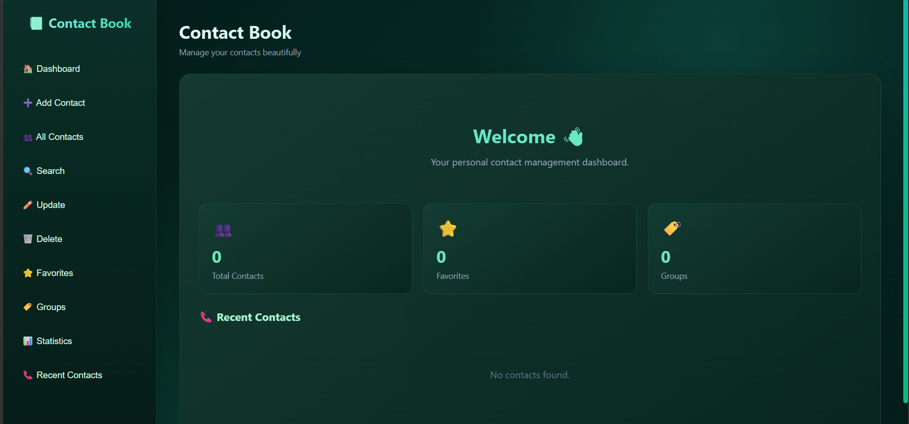
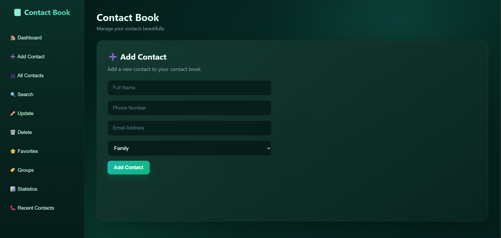
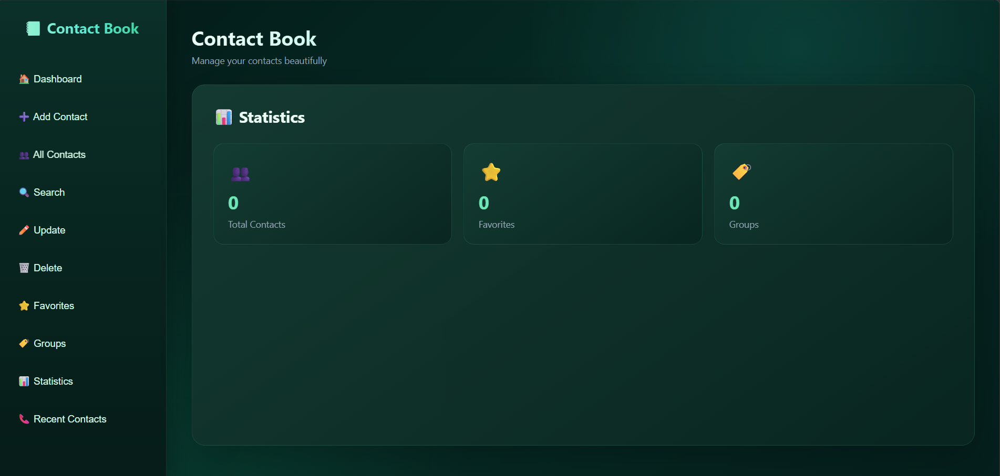

# 📱 Contact Book

> A modern full-stack Contact Management System built with **HTML, CSS, JavaScript, Python and FastAPI**.

Contact Book is a simple and user-friendly application for managing personal contacts. It provides contact management, search, favorites, groups, statistics, recent contacts and CSV export through a clean modern interface.

---

## 📸 Project Preview

### 🏠 Dashboard



The dashboard provides an overview of total contacts, favorites, groups and recent contacts.

### ➕ Add Contact



Users can add contacts with their name, phone number, email address and group.

### 📊 Statistics



The statistics section provides a quick overview of contacts, favorites and groups.

---

## ✨ Features

### 👤 Contact Management

- ➕ Add contacts
- 👥 View all contacts
- 🔍 Search contacts by name
- 📞 Search contacts by phone number
- ✏️ Update contact information
- 🗑️ Delete contacts

### ⭐ Organization

- ⭐ Mark contacts as favorites
- 🏷️ Organize contacts into groups
- 📊 View contact statistics
- 📞 View recent contacts

### 📤 Data Management

- 💾 Local JSON data storage
- 📄 Export contacts to CSV
- 🔐 Private contact data excluded from GitHub

### 🎨 User Interface

- 🌙 Modern dark interface
- 💚 Emerald/teal theme
- ✨ Gradient and glassmorphism design
- 🧭 Sidebar navigation
- 📱 Responsive layout
- 🎯 Clean and simple user experience

---

## 🛠️ Tech Stack

### Frontend

- **HTML5** — Application structure
- **CSS3** — Styling, gradients and responsive design
- **JavaScript** — DOM manipulation and API communication

### Backend

- **Python**
- **FastAPI**
- **Pydantic**
- **Uvicorn**

### Data Storage

- **JSON**

### Development Tools

- Visual Studio Code
- Git
- GitHub
- FastAPI Swagger UI
- Live Server

---

## 🏗️ Application Architecture

```text
                    👤 USER
                       │
                       ▼
              ┌───────────────────┐
              │     FRONTEND      │
              │                   │
              │  HTML + CSS + JS  │
              └─────────┬─────────┘
                        │
                        │ HTTP / JSON
                        ▼
              ┌───────────────────┐
              │      FASTAPI      │
              │      BACKEND      │
              │                   │
              │    REST APIs      │
              └─────────┬─────────┘
                        │
                        │ Read / Write
                        ▼
              ┌───────────────────┐
              │   contacts.json   │
              │                   │
              │   Data Storage    │
              └───────────────────┘
```

---

## 📂 Project Structure

```text
contact-book/
│
├── backend/
│   ├── main.py
│   ├── contacts.example.json
│   └── contacts.json
│
├── frontend/
│   ├── index.html
│   ├── script.js
│   └── style.css
│
├── screenshots/
│   ├── dashboard.png
│   ├── add-contact.png
│   └── statistics.png
│
├── .gitignore
└── README.md
```

---

## 🔄 How It Works

The application follows a simple full-stack architecture:

```text
User
 ↓
HTML Interface
 ↓
JavaScript
 ↓
Fetch API
 ↓
FastAPI REST API
 ↓
Python Backend
 ↓
contacts.json
```

### Example: Adding a Contact

```text
User enters contact details
        ↓
JavaScript collects the data
        ↓
POST /contacts
        ↓
FastAPI receives the request
        ↓
Pydantic validates the data
        ↓
Contact is stored
        ↓
JSON response is returned
        ↓
Frontend updates the UI
```

---

## 🔌 REST API Endpoints

| Method | Endpoint | Description |
|---|---|---|
| GET | `/` | Check API status |
| POST | `/contacts` | Create a contact |
| GET | `/contacts` | Get all contacts |
| GET | `/contacts/search/name/{name}` | Search by name |
| GET | `/contacts/search/phone/{phone}` | Search by phone |
| PUT | `/contacts/{id}` | Update a contact |
| DELETE | `/contacts/{id}` | Delete a contact |
| PATCH | `/contacts/{id}/favorite` | Toggle favorite |
| GET | `/contacts/favorites` | Get favorite contacts |
| GET | `/contacts/groups` | Get contact groups |
| GET | `/contacts/recent` | Get recent contacts |
| GET | `/contacts/statistics` | Get statistics |

---

# 🚀 Installation & Setup

## 1. Clone the Repository

```bash
git clone https://github.com/arafat-techie/contact-book.git
```

Move into the project:

```bash
cd contact-book
```

---

## 2. Set Up the Backend

Open the backend folder:

```bash
cd backend
```

Install the required packages:

```bash
python -m pip install fastapi uvicorn
```

---

## 3. Start the FastAPI Server

Run:

```bash
python -m uvicorn main:app --reload
```

The backend will run at:

```text
http://127.0.0.1:8000
```

---

## 4. Open API Documentation

FastAPI provides automatic interactive API documentation.

Open:

```text
http://127.0.0.1:8000/docs
```

You can test the API endpoints directly using Swagger UI.

---

## 5. Run the Frontend

Open the `frontend` folder in VS Code.

Open `index.html` using **Live Server**.

The frontend communicates with the FastAPI backend at:

```text
http://127.0.0.1:8000
```

---

# 💾 Data Storage & Privacy

The project currently uses a local JSON file:

```text
backend/contacts.json
```

Example structure:

```json
[
    {
        "id": "123456",
        "name": "Example User",
        "phone": "9876543210",
        "email": "example@gmail.com",
        "group": "Friends",
        "favorite": false
    }
]
```

### 🔐 Privacy

Real contact information should **never be uploaded to a public GitHub repository**.

Therefore:

```text
backend/contacts.json
```

is excluded using `.gitignore`.

The repository contains:

```text
backend/contacts.example.json
```

as a safe example file.

---

# 🧠 Concepts Learned

This project helped me practice important software development concepts.

### Frontend

- HTML5
- CSS3
- Flexbox
- CSS Grid
- Responsive design
- JavaScript
- DOM manipulation
- Event listeners
- Forms
- Fetch API
- JSON
- Async/Await

### Backend

- Python
- FastAPI
- REST APIs
- HTTP methods
- Pydantic
- CRUD operations
- API routing
- CORS
- JSON file handling

### Development

- Git
- GitHub
- `.gitignore`
- Frontend-backend integration
- API testing
- Project organization

---

# 🎯 Project Objective

The main objective of this project was to understand how a complete full-stack application works.

The project demonstrates:

```text
User Interface
      ↓
JavaScript
      ↓
REST API
      ↓
FastAPI
      ↓
Data Validation
      ↓
Data Storage
```

It was also created to strengthen practical knowledge of **frontend development, backend development and API integration**.

---

# 📈 Future Improvements

The current version uses JSON storage for learning purposes.

Future versions can include:

- [ ] MongoDB database
- [ ] PostgreSQL support
- [ ] User authentication
- [ ] Login and registration
- [ ] JWT authentication
- [ ] Password hashing
- [ ] Import contacts from CSV
- [ ] Contact profile page
- [ ] Contact profile photos
- [ ] Trash and restore system
- [ ] Advanced filtering
- [ ] Pagination
- [ ] Contact sharing
- [ ] Cloud deployment
- [ ] Production-level security
- [ ] Mobile application

---

# 🚀 Future Architecture

For a more scalable version, JSON storage can be replaced with MongoDB:

```text
                 FRONTEND
              HTML / CSS / JS
                    │
                    ▼
                 FASTAPI
                    │
                    ▼
                  MONGODB
                    │
                    ▼
             CONTACT DATABASE
```

This would make the application more suitable for:

- Multiple users
- Large datasets
- Cloud deployment
- Scalable applications
- Production environments

---

# 👨‍💻 Author

## MD Yasir Arafat

**B.Tech — Computer Science & Engineering**  
**Data Science & Artificial Intelligence**

### GitHub

🔗 https://github.com/arafat-techie

### Areas of Interest

- 🐍 Python
- ⚡ FastAPI
- 🔌 REST APIs
- 🌐 Web Development
- 📊 Data Science
- 🤖 Artificial Intelligence
- 🧠 Machine Learning

---

# ⭐ Support

If you find this project useful or interesting, consider giving the repository a ⭐ on GitHub.

---

## 📜 License

This project was created for **educational and learning purposes**.